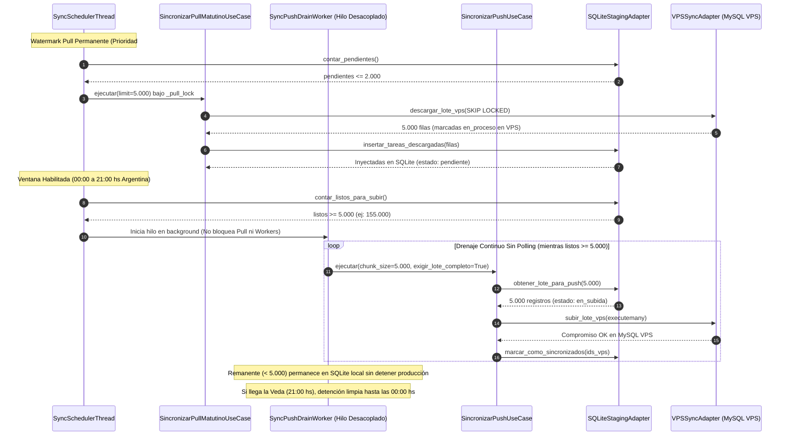

# Casos de Uso: Sincronización Matutina (Pull) y Subida Continua al VPS (Push)

> **Capa 02: Dominio y Casos de Uso** | Orquestación Desacoplada Staging <-> VPS

Los casos de uso [`SincronizarPullMatutinoUseCase`](file:///c:/Users/Usuario/Documents/GitHub/scrapers-reg-no-llame/core/use_cases/sync_pull_use_case.py) y [`SincronizarPushNocturnoUseCase`](file:///c:/Users/Usuario/Documents/GitHub/scrapers-reg-no-llame/core/use_cases/sync_push_use_case.py) (con alias universal [`SincronizarPushUseCase`](file:///c:/Users/Usuario/Documents/GitHub/scrapers-reg-no-llame/core/use_cases/sync_push_use_case.py#L181)) regulan el flujo de datos entre el VPS central MySQL y el almacenamiento local SSD (SQLite WAL), garantizando el desacoplamiento total de los workers y la continuidad de producción.

---

## 1. Diagrama de Secuencia de Sincronización Desacoplada

---

## 2. Contratos Hexagonales de Sincronización

Definidos en [`core/ports/sync_port.py`](file:///c:/Users/Usuario/Documents/GitHub/scrapers-reg-no-llame/core/ports/sync_port.py):

### Puerto Remoto: `ISyncRemoteRepoPort`
- `descargar_lote_vps(tipo_cola, limit, auto_id, pc_id, scraper_actual) -> List[Dict]`: Ejecuta la descarga atómica con `SELECT ... FOR UPDATE SKIP LOCKED` y marca las filas como `en_proceso` o `procesando` en MySQL VPS.
- `subir_lote_vps(tipo_cola, lote) -> int`: Ejecuta una transacción atómica con `executemany()` para un chunk de 5.000 registros.

### Puerto Local: `ISyncLocalRepoPort`
- `insertar_tareas_descargadas(tareas, tipo_cola) -> int`: Inserción masiva en SQLite con `ON CONFLICT DO NOTHING`.
- `obtener_lote_para_push(limit, tipo_cola) -> List[Dict]`: Reserva atómica de filas terminadas (`listo_para_subir` o `fallido`) pasando a `en_subida`.
- `marcar_como_sincronizados(ids_vps, tipo_cola) -> bool`: Registro de `fecha_sincronizado = CURRENT_TIMESTAMP` y estado `sincronizado`.
- `revertir_subida_a_listo(ids_vps, tipo_cola) -> bool`: Reversión de `en_subida` a `listo_para_subir` si falla la transacción remota.
- `purgar_antiguos(dias_retencion) -> int`: Purga rotativa de tareas sincronizadas con más de 7 días.
- `contar_pendientes(tipo_cola, scraper_actual) -> int`: Conteo de tareas en estado `pendiente` por scraper o global.
- `contar_listos_para_subir(tipo_cola) -> int`: Conteo de tareas listas para subir (`listo_para_subir` o `fallido`).

---

## 3. Especificación de Reglas de Negocio Universales

La política transversal [`PoliticaVentanaPush`](file:///c:/Users/Usuario/Documents/GitHub/scrapers-reg-no-llame/core/domain/schedule.py#L152) y el orquestador [`SyncSchedulerThread`](file:///c:/Users/Usuario/Documents/GitHub/scrapers-reg-no-llame/runtime/sync_scheduler.py#L31) aplican las siguientes reglas:

| Regla | Parámetro | Valor | Justificación Técnica |
|---|---|---|---|
| **Ventana Habilitada de Subida** | `SYNC_PUSH_WINDOW_START_HOUR` / `END_HOUR` | `0` a `21` hs | Habilitado las 24 horas a excepción de la veda nocturna de 21:00 a 00:00 hs (Horario de Argentina / `America/Argentina/Buenos_Aires`). |
| **Veda Nocturna de Subida** | `SYNC_PUSH_BLACKOUT_START_HOUR` | `21` a `00` hs | Bloqueo absoluto de subidas al VPS durante el cierre de turnos y sincronizaciones centrales de base de datos. |
| **Disparo por Lote Completo** | `chunk_size` | `5000` | La subida masiva al VPS se dispara únicamente cuando se completa un lote de al menos 5.000 registros listos. |
| **Drenaje Continuo Sin Polling** | `_run_push_drain_loop` | Continuo mientras `listos >= 5000` | Si hay un gran volumen acumulado (ej. 155k registros), sube en ciclos consecutivos inmediatos de 5.000 (31 ciclos) sin sleeps ni pausas de sondeo. |
| **No Parar Producción** | `exigir_lote_completo` | `True` | Remanentes menores a 5.000 registros no se fuerzan al VPS: se preservan en SQLite local para que los workers sigan procesando sin pausas. |
| **Desacoplamiento Concurrente** | `_pull_lock` / `_push_lock` | Locks independientes | El hilo de Watermark Pull puede recargar la cola local concurrentemente con la subida masiva sin bloquearse mutuamente. |
| **Pool de Conexiones VPS** | `VPSSyncAdapter.pool_size` | `4` conexiones | Permite transacciones simultáneas de descarga (Pull) y subida (Push) sin agotar el pool de MySQL. |
| **Pausa Cooperativa** | `SYNC_PUSH_ROUNDROBIN_PAUSE_SEC` | `0.5s` | Pausa milimétrica entre chunks de 5.000 para no saturar binlogs y ceder turno a otros nodos en red. |
| **Subida Forzada CLI** | `--sync-now` / `--force-push` | Flag CLI | Permite ignorar la restricción horaria o subir remanentes menores a 5.000 al cerrar turnos. |
| **Retención Rotativa** | `SYNC_RETENTION_DAYS` | `7` días | Limpieza periódica de registros sincronizados en SQLite local para mantener la base liviana en SSD. |

---

## 4. Documentos Relacionados

- [08. Esquema DDL en VPS Central](../03_base_de_datos_y_colas/esquema_ddl_vps.md)
- [06. Caso de Uso: Procesar Lote](caso_uso_procesar_lote.md)
- [07. Caso de Uso: Liberar Huérfanos](caso_uso_liberar_huerfanos.md)
- [23. Supervisor Inmortal y Auto-Spawn](../06_runtime_y_concurrencia/supervisor_inmortal.md)

