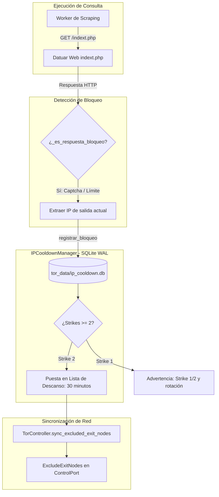

# Gestor de Lista de Descanso y Cooldown de IPs (`IPCooldownManager`)

Este documento detalla la arquitectura, el diseño de persistencia multiproceso y el protocolo de cuarentena del **Gestor de Lista de Descanso de IPs** ([`IPCooldownManager`](file:///C:/Users/Usuario/Documents/GitHub/scrapers-reg-no-llame/adapters/network/cooldown_manager.py)), diseñado bajo los principios de la **Arquitectura Hexagonal (Puertos y Adaptadores)** para aislar dinámicamente cualquier nodo de salida o proxy que presente bloqueos de tasa o desafíos de captcha (Cloudflare Turnstile / `fa-shield-halved`) en [Datuar](file:///C:/Users/Usuario/Documents/GitHub/scrapers-reg-no-llame/adapters/scrapers/datuar/datuar_adapter.py).

---

## 1. Justificación y Diagnóstico del Bloqueo por Captcha

En operaciones de scraping sostenido sobre portales con protección perimetral anti-bot:

1. **Persistencia de Desafío por IP**: Cuando un portal como Datuar activa un desafío de verificación o límite de búsquedas sobre una dirección IP específica, las consultas posteriores que utilicen esa misma IP fallan inmediatamente con códigos HTTP 403/429 o pantallas de validación (`fa-shield-halved`, `superado el límite`).
2. **Ciclo de Reintentos Inútiles**: Si los workers continúan recibiendo o reutilizando esa misma IP quemada, se desperdician ciclos de CPU, cuotas de red y se degrada la latencia promedio del enjambre concurrente.
3. **Regla de 2 Strikes**: Una única respuesta anómala puede ser una fluctuación transitoria, pero **dos respuestas consecutivas de bloqueo o captcha** en la misma IP confirman que la dirección está fichada por el WAF perimetral.

---

## 2. Arquitectura del Subsistema y Flujo de Aislamiento

[`IPCooldownManager`](file:///C:/Users/Usuario/Documents/GitHub/scrapers-reg-no-llame/adapters/network/cooldown_manager.py) opera como un adaptador secundario compartido entre todos los subprocesos de la máquina:



---

## 3. Especificación Técnica de Persistencia Multiproceso

Dado que el [`SupervisorIndustrial`](file:///C:/Users/Usuario/Documents/GitHub/scrapers-reg-no-llame/runtime/supervisor.py) orquesta hasta 20 workers en subprocesos independientes (`multiprocessing`), la lista de descanso debe ser **inmune a condiciones de carrera multiproceso** sin depender de memoria compartida frágil.

Se utiliza SQLite embebido en modo **WAL (Write-Ahead Logging)** sobre la ruta `tor_data/ip_cooldown.db`:

```sql
CREATE TABLE IF NOT EXISTS ip_strikes (
    ip TEXT PRIMARY KEY,
    strikes INTEGER DEFAULT 0,
    ultimo_bloqueo REAL DEFAULT 0,
    cooldown_hasta REAL DEFAULT 0,
    en_descanso INTEGER DEFAULT 0,
    total_cooldowns INTEGER DEFAULT 0
);
```

### Métodos del Adaptador `IPCooldownManager`:

| Método | Firma | Descripción |
| :--- | :--- | :--- |
| `registrar_bloqueo` | `(ip: str, cooldown_segundos: float = 1800.0) -> Tuple[int, bool]` | Incrementa los strikes de la IP. Si alcanza 2 strikes, activa `en_descanso = 1` y fija `cooldown_hasta = now + cd`. |
| `esta_en_descanso` | `(ip: str) -> bool` | Comprueba si la IP está en cuarentena activa. Si el tiempo expiró, la limpia automáticamente y retorna `False`. |
| `reportar_exito` | `(ip: str) -> None` | Resetea los strikes a 0 cuando la IP responde limpiamente sin bloqueos. |
| `obtener_ips_en_descanso` | `() -> List[str]` | Retorna todas las IPs con descanso vigente (`en_descanso = 1 AND cooldown_hasta > now`). |
| `limpiar_todo` | `() -> None` | Trunca la base de datos para reinicios limpios de entorno. |

---

## 4. Integración Dinámica con el Pool Multi-Instancia de Tor

Cuando una IP de salida alcanza los 2 strikes, [`TorController.sync_excluded_exit_nodes`](file:///C:/Users/Usuario/Documents/GitHub/scrapers-reg-no-llame/adapters/network/tor_controller.py) propaga la lista actualizada a todas las instancias activas de Tor mediante el comando de protocolo ControlPort:

```python
controller.set_conf("ExcludeExitNodes", ",".join(excluded_ips))
```

* **Sin Reinicio de Proceso**: Tor aplica la exclusión en caliente en memoria sin interrumpir las transferencias de los demás workers.
* **Auto-Recuperación ("Potable de Vuelta")**: El centinela [`_tor_pool_watchdog_loop`](file:///C:/Users/Usuario/Documents/GitHub/scrapers-reg-no-llame/runtime/supervisor.py) audita periódicamente la lista. Cuando los 30 minutos expiran, la IP se remueve de `ExcludeExitNodes` y vuelve a ser admisible en la red Tor.

---

## 5. Documentos Relacionados

* [Pool Multi-Instancia de Tor y Centinela](pool_tor_multi_instancia.md)
* [Supervisor Inmortal y Auto-Spawn](supervisor_inmortal.md)
* [Adaptador Scraper Datuar](../05_guia_nuevos_scrapers/guia_creacion_datuar.md)
* [Circuit Breaker de Red y VPN](circuit_breaker_red.md)
