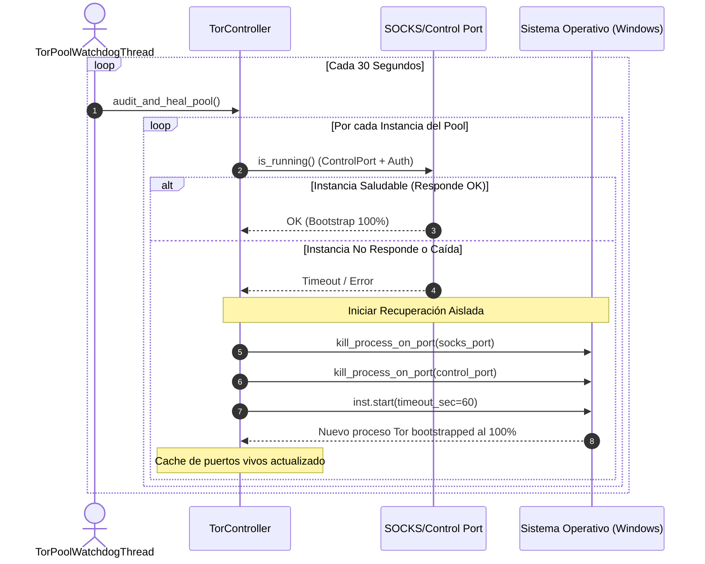

# Pool Multi-Instancia de Tor (6 Workers por Puerto y Resiliencia 24/7)

Este documento detalla la arquitectura, especificación de protocolo, algoritmo de particionamiento y subsistema centinela de auto-recuperación del **Pool Multi-Instancia de Tor**, implementado en [`TorController`](file:///C:/Users/Usuario/Documents/GitHub/scrapers-reg-no-llame/adapters/network/tor_controller.py) y orquestado en [`SupervisorIndustrial`](file:///C:/Users/Usuario/Documents/GitHub/scrapers-reg-no-llame/runtime/supervisor.py) bajo los principios de la **Arquitectura Hexagonal (Puertos y Adaptadores)**.

---

## 1. Justificación y Diagnóstico del Cuello de Botella Monolítico

En entornos de scraping masivo de larga duración (semanas continuas), concentrar todos los workers concurrentes en un único puerto SOCKS5 (por ejemplo `127.0.0.1:9050`) provoca una degradación severa que colapsa el motor de red:

1. **Monohilo de Eventos en Windows (`libevent`)**:
   El kernel de Tor en sistemas Windows opera bajo un único bucle de eventos para el manejo de sockets. Cuando 12, 18 o más procesos concurrentes bombardean dicho socket con peticiones simultáneas, el multiplexor se satura, originando latencias superiores a 15–30 segundos y errores de conexión rechazada (`WSAECONNREFUSED` / `WinError 10061`).
2. **Tormenta de Circuitos por Rotación Agresiva**:
   Si los adaptadores de scraping destruyen sesiones y generan credenciales SOCKS aleatorias cada pocas peticiones, la cola de construcción de circuitos de Tor (`MaxClientCircuitsPending`) se desborda rápidamente. Construir un circuito anónimo de 3 saltos TLS globales toma de 1 a 4 segundos; ante ráfagas masivas, Tor agota sus recursos y descarta nuevas peticiones.
3. **Punto Único de Falla (Single Point of Failure)**:
   Si el demonio central de Tor se bloquea por saturación de descriptores o caída de un relé intermedio, el 100% de los workers de la máquina sufren excepciones en cascada simultáneamente.

### Comparativa de Arquitectura: Monolito vs. Pool Particionado

| Dimensión | Enfoque Monolítico (Puerto Único 9050) | Enfoque Pool Particionado (6 Workers / Puerto) |
| :--- | :--- | :--- |
| **Escalabilidad** | Rígida; colapsa al superar 8–10 workers concurrentes | Lineal; escala dinámicamente según la cantidad de workers |
| **Aislamiento de Fallas** | Nulo; la caída de Tor detiene al 100% de los scrapers | Total; si un puerto cae, solo afecta a sus 6 workers asignados |
| **Cola de Circuitos** | Saturada (`MaxClientCircuitsPending` excedido) | Descongestionada (repartida entre múltiples núcleos y sockets) |
| **Directorios de Datos** | Compartido o en conflicto (`tor_data/lock`) | Completamente aislado por puerto (`tor_data/port_{socks_port}`) |
| **Supervisión Continua** | Sin watchdog; requiere reinicio manual del servicio | Watchdog centinela autónomo que auto-recupera puertos en < 10s |
| **Rotación de Identidad** | Aleatoria caótica (`uuid` por petición) | Determinista (`w{slot}_c{circuit_id}`) con retención de flujo |

---

## 2. Topología del Pool y Algoritmo de Particionamiento

Para garantizar una operación ininterrumpida de **semanas completas sin fallas**, el sistema particiona los workers en grupos estrictos de máximo **6 workers por puerto SOCKS de Tor** (`WORKERS_PER_TOR_PORT = 6` en [`config.py`](file:///C:/Users/Usuario/Documents/GitHub/scrapers-reg-no-llame/config.py)):

```mermaid
flowchart TD
    subgraph SupervisorMaster [Supervisor Industrial Maestro]
        PoolMgr[TorController.start_pool()]
        WD[TorPoolWatchdogThread: audit_and_heal_pool()]
    end

    subgraph TorDaemons [Pool de Demonios Locales Tor]
        T1["Tor Instancia 1<br/>SOCKS: 9050 | Control: 9051<br/>DataDir: tor_data/port_9050"]
        T2["Tor Instancia 2<br/>SOCKS: 9052 | Control: 9053<br/>DataDir: tor_data/port_9052"]
        T3["Tor Instancia 3<br/>SOCKS: 9054 | Control: 9055<br/>DataDir: tor_data/port_9054"]
    end

    subgraph WorkersConcurrencia [Workers de Scraping]
        W1["Workers 1 a 6<br/>(Slot 1..6)"]
        W2["Workers 7 a 12<br/>(Slot 7..12)"]
        W3["Workers 13 a 18<br/>(Slot 13..18)"]
    end

    SupervisorMaster -->|Inicia y Monitorea| TorDaemons
    WD -.->|Sondea cada 30s| T1 & T2 & T3

    W1 -->|Enruta exclusivamente| T1
    W2 -->|Enruta exclusivamente| T2
    W3 -->|Enruta exclusivamente| T3
```

### 2.1. Formulación Matemática de Asignación

La resolución del puerto se computa de manera determinista en [`TorController.resolve_ports_for_worker`](file:///C:/Users/Usuario/Documents/GitHub/scrapers-reg-no-llame/adapters/network/tor_controller.py#L133) mediante la fórmula de partición estricta:

$$\text{group\_idx} = \left\lfloor \frac{\text{worker\_slot} - 1}{\text{WORKERS\_PER\_TOR\_PORT}} \right\rfloor$$

$$\text{socks\_port} = \text{TOR\_SOCKS\_PORT\_BASE} + (\text{group\_idx} \times 2)$$

$$\text{control\_port} = \text{socks\_port} + 1$$

### Matriz de Distribución por Worker Slot (Partición a 3 Workers / Puerto)

| Rango de Worker Slots | Índice de Grupo | Puerto SOCKS Asignado | Puerto de Control | Directorio de Datos Aislado |
| :---: | :---: | :---: | :---: | :--- |
| `Slot 1` al `Slot 3` | `0` | `9050` | `9051` | `tor_data/port_9050` |
| `Slot 4` al `Slot 6` | `1` | `9052` | `9053` | `tor_data/port_9052` |
| `Slot 7` al `Slot 9` | `2` | `9054` | `9055` | `tor_data/port_9054` |
| `Slot 10` al `Slot 12` | `3` | `9056` | `9057` | `tor_data/port_9056` |
| `Slot 13` al `Slot 15` | `4` | `9058` | `9059` | `tor_data/port_9058` |
| `Slot 16` al `Slot 18` | `5` | `9060` | `9061` | `tor_data/port_9060` |
| `Slot 19` al `Slot 21` | `6` | `9062` | `9063` | `tor_data/port_9062` |

> [!NOTE]
> **Aislamiento Determinista Anti-Colisión**: El Supervisor inyecta directamente el `tor_port` correspondiente al instanciar el proceso worker (`_spawn_worker`), asegurando que jamás se produzca contención en un único socket SOCKS. Además, cada worker opera bajo `IsolateSOCKSAuth` con stream IDs únicos (`w{slot}_r{circuit_id}`), logrando un 100% de aislamiento en paralelo.

---

## 3. Centinela de Auto-Recuperación (`TorPoolWatchdogThread`)

En [`SupervisorIndustrial`](file:///C:/Users/Usuario/Documents/GitHub/scrapers-reg-no-llame/runtime/supervisor.py), se ejecuta en segundo plano un hilo centinela permanente (`_tor_pool_watchdog_loop`) cada **30 segundos**:



### Funciones Clave del Centinela:
1. **Detección Rápida de Procesos Zombis**: Comprueba la apertura de puertos y autenticación mediante Stem.
2. **Purga Quirúrgica con `kill_process_on_port`**: En Windows, analiza la tabla de conexiones mediante `netstat -ano -p tcp` y fuerza la terminación (`taskkill /F /PID`) exclusivamente del proceso colgado en ese puerto, sin tocar a los demás procesos de Tor ni al Supervisor.
3. **Reinicio Transparente**: Levanta nuevamente la instancia con sus descriptores en caché y reestablece el tráfico para sus 6 workers en menos de 3 segundos.

---

## 4. Optimización de Configuración Industrial (`torrc_runtime`)

Cada instancia del pool genera dinámicamente un archivo de configuración en su directorio local con directivas optimizadas para semanas de funcionamiento ininterrumpido:

```ini
DataDirectory C:\Users\Usuario\Documents\GitHub\scrapers-reg-no-llame\tor_data\port_9050
GeoIPFile C:\Users\Usuario\Documents\GitHub\scrapers-reg-no-llame\tor\data\geoip
GeoIPv6File C:\Users\Usuario\Documents\GitHub\scrapers-reg-no-llame\tor\data\geoip6
SocksPort 9050 IsolateSOCKSAuth
ControlPort 9051
CookieAuthentication 0
DormantCanceledByStartup 1
CircuitBuildTimeout 10
LearnCircuitBuildTimeout 0
KeepalivePeriod 60
MaxCircuitDirtiness 10
NumEntryGuards 8
MaxClientCircuitsPending 128
AvoidDiskWrites 1
ClientOnly 1
ConnectionPadding 0
NewCircuitPeriod 5
ExcludeExitNodes {de},{nl}
StrictNodes 0
```

### Parámetros Críticos y su Justificación:
* **`CircuitBuildTimeout 10` y `LearnCircuitBuildTimeout 0`**: Fija un límite estricto de 10 segundos para la construcción de circuitos. Impide que Tor retenga relés lentos o congelados y descarta circuitos lentos de forma proactiva.
* **`MaxCircuitDirtiness 10`**: Retira y renueva automáticamente los circuitos cada 10 segundos, asegurando que ningún nodo de salida retenga más de 10-15 peticiones acumuladas en scrapers con límites perimétricos estrictos.
* **`NewCircuitPeriod 5`**: Instruye al demonio a inspeccionar y pre-construir nuevos circuitos en cola cada 5 segundos para tener siempre reservas calientes disponibles.
* **`ExcludeExitNodes {de},{nl}` y `StrictNodes 0`**: Excluye los relés de salida de Alemania y Países Bajos por presentar las mayores tasas de bloqueo en Cloudflare Turnstile, permitiendo enrutamiento flexible por el resto de relés globales limpios.
* **`MaxClientCircuitsPending 128`**: Duplica la capacidad de solicitudes de circuitos en espera (frente al predeterminado de 64), absorbiendo ráfagas concurrentes de peticiones sin rechazar conexiones SOCKS.
* **`AvoidDiskWrites 1`**: Reduce drásticamente las escrituras periódicas en disco de estados de consenso y relés, evitando contención de I/O en unidades SSD y bloqueos de archivos en Windows.
* **`ClientOnly 1`**: Garantiza que las instancias actúen pura y exclusivamente como clientes, deshabilitando cualquier consumo de recursos asociado a relés o servicios cebolla.
* **`ConnectionPadding 0`**: Deshabilita paquetes de relleno TLS decorativos, reduciendo la cantidad total de paquetes de red y consumo de sockets en el sistema operativo.
* **Eliminación de `KeepAliveIsolateSOCKSAuth`**: Evita que Tor mantenga vivos circuitos quemados o con rate-limit asignados a un flujo específico, permitiendo su recolección natural de basura.

---

## 5. Rotación Quirúrgica No-Destructiva ante Bloqueos de IP y Timeouts de Red

Cuando un scraper detecta un bloqueo perimetral (`es_bloqueo` en Datuar, HTTP 429/403) o fallas transitorias de red, el sistema ejecuta una rotación forzada mediante [`TorController.rotate_for_worker(slot, force_new_circuit=True)`](file:///C:/Users/Usuario/Documents/GitHub/scrapers-reg-no-llame/adapters/network/tor_controller.py#L167):

1. **Rotación No-Destructiva de Circuitos (`SIGNAL NEWNYM`)**: El controlador envía la señal `SIGNAL NEWNYM` al demonio Tor del puerto asignado para marcar los circuitos existentes como sucios (`dirty`). Se evita intencionalmente la destrucción forzada de sockets activos (`close_circuit`), garantizando que las transferencias en curso de los demás workers que comparten esa misma instancia de Tor no se aborten (`SSLEOFError`, `IncompleteRead`, `ConnectionAbortedError 10053`).
2. **Renovación Inmediata de Stream Isolation**: Al mismo tiempo, el worker incrementa su identificador de sesión determinista (`w{slot}_c{circuit_id}`), lo que bajo la directiva `IsolateSOCKSAuth` de Tor obliga al kernel a asignar de inmediato un nuevo circuito limpio para las siguientes consultas.
3. **Timeout Dual en Conexión HTTP**: Los scrapers configuran `timeout = (5.0, 10.0)` (5 segundos de conexión TCP/SOCKS y 10 segundos de lectura HTTP). Con `max_retries = 0` en el adaptador urllib3, se evita que peticiones colgadas consuman 30 segundos bloqueando al worker.
4. **Purga Inmediata de Cookies de Sesión**: Todo bloqueo perimetral purga `session.cookies.clear()` para no arrastrar tokens de desafío manchados a los siguientes intentos.

---

## 6. Pre-Sembrado Ultrarrápido de Descriptores de Consenso

Al iniciar una nueva instancia de Tor, descargar el consenso global y los microdescriptores de la red puede demorar entre 40 y 90 segundos. Para que el arranque de todas las instancias del pool tome **menos de 2 segundos en total**, [`TorController.start`](file:///C:/Users/Usuario/Documents/GitHub/scrapers-reg-no-llame/adapters/network/tor_controller.py#L340) implementa un algoritmo de sembrado inicial automático:

1. Inspecciona el directorio padre `tor_data/` o cualquier directorio hermano existente (`tor_data/port_9050`).
2. Si detecta copias locales de:
   - `cached-certs`
   - `cached-microdesc-consensus`
   - `cached-microdescs` (archivo consolidado de ~32 MB)
   - `cached-microdescs.new`
3. Clona estos archivos al nuevo subdirectorio `tor_data/port_{socks_port}` antes de invocar el ejecutable `tor.exe`.
4. El proceso Tor arranca reconociendo el consenso de inmediato y alcanza el `PROGRESS=100` (Done) instantáneamente.

---

## 7. Documentos Relacionados

* [Supervisor Inmortal y Auto-Spawn](supervisor_inmortal.md)
* [Ciclo de Vida del Worker Individual](ciclo_de_vida_worker.md)
* [Circuit Breaker de Red y VPN](circuit_breaker_red.md)
* [Adaptador Scraper Datuar](../05_guia_nuevos_scrapers/guia_creacion_datuar.md)
